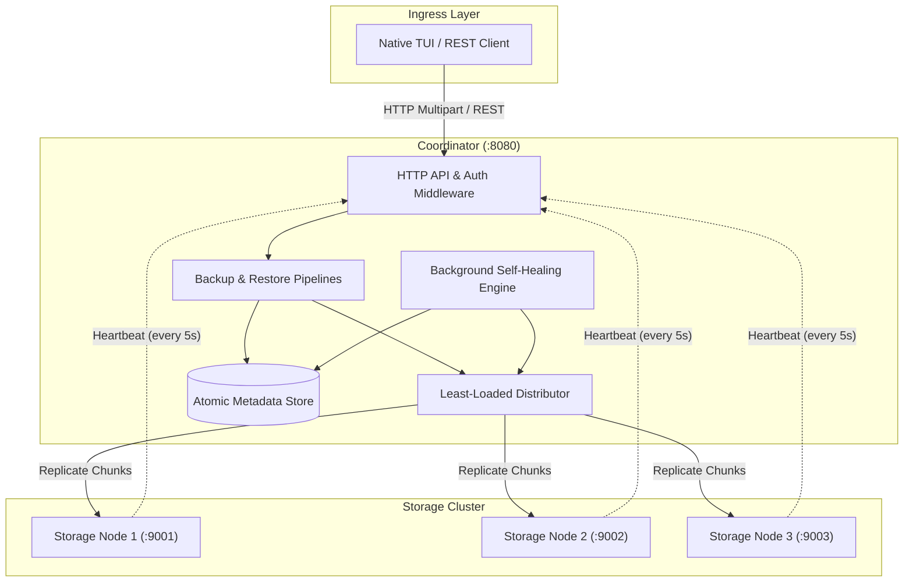
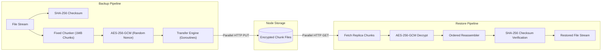

# fudou

a distributed backup system and storage cluster built in go, with a native terminal dashboard. the coordinator chunks file streams, encrypts them server-side with aes-256-gcm, and distributes them across independent storage nodes with 3x replication by default. if a node drops offline, fudou detects the heartbeat loss and heals the cluster automatically. the backend uses only the go standard library; the terminal frontend uses Bubble Tea, Bubbles, and Lip Gloss.

---

## contents

- [features](#features)
- [architecture](#architecture)
- [technologies and stack](#technologies-and-stack)
- [native terminal dashboard](#native-terminal-dashboard)
  - [dashboard capabilities](#dashboard-capabilities)
  - [launch the tui](#launch-the-tui)
  - [keyboard controls](#keyboard-controls)
  - [backup, keys, and restore](#backup-keys-and-restore)
- [quickstart and cli reference](#quickstart-and-cli-reference)
  - [1. build binaries from source](#1-build-binaries-from-source)
  - [2. run the coordinator service](#2-run-the-coordinator-service)
  - [3. run storage node daemons](#3-run-storage-node-daemons)
  - [4. launch multi-node cluster with docker compose](#4-launch-multi-node-cluster-with-docker-compose)
  - [5. environment variables and configuration reference](#5-environment-variables-and-configuration-reference)
- [api reference and curl examples](#api-reference-and-curl-examples)
  - [generate authentication token](#generate-authentication-token)
  - [upload and backup a file](#upload-and-backup-a-file)
  - [list stored files](#list-stored-files)
  - [download and restore a file](#download-and-restore-a-file)
  - [delete a file](#delete-a-file)
  - [query cluster topology and telemetry](#query-cluster-topology-and-telemetry)
  - [query aggregate cluster metrics](#query-aggregate-cluster-metrics)
- [project structure](#project-structure)
- [how distributed backup works in fudou](#how-distributed-backup-works-in-fudou)
  - [stream chunking and segmentation](#stream-chunking-and-segmentation)
  - [aes-256-gcm authenticated encryption](#aes-256-gcm-authenticated-encryption)
  - [least-loaded n-way replication](#least-loaded-n-way-replication)
  - [automated self-healing engine](#automated-self-healing-engine)
- [testing](#testing)
- [license](#license)

---

## features

- zero external dependencies in the backend: built entirely on the go standard library with net/http, crypto/aes, crypto/cipher, crypto/sha256, and sync primitives.
- stream-based fixed chunking: files are segmented into fixed 1MB chunks on the fly without buffering entire files in memory, keeping ram usage low regardless of file size.
- coordinator-side encryption: every file upload generates a unique 256-bit encryption key and 96-bit nonces per chunk with aes-256-gcm. storage nodes hold ciphertext, but the coordinator processes plaintext and keys; it is a trusted part of the system.
- sha-256 checksum verification: cryptographic digests are computed on raw streams before chunking and re-verified byte-by-byte upon restore to catch silent data corruption or tampering.
- n-way replication: every chunk is copied across multiple storage nodes (3x by default) using a least-loaded placement strategy that prioritizes nodes with the most free capacity.
- self-healing cluster: a background worker audits chunk replicas every 10 seconds. if a storage node stops sending heartbeats, missing chunks are automatically re-replicated to healthy nodes.
- independent storage daemons: nodes run as standalone http services with isolated disk directories, atomic writes, and periodic heartbeat beacons.
- hmac-sha256 token authentication: signed bearer tokens protect api endpoints and allow role-based authorization.
- native terminal dashboard: a styled, keyboard-driven go frontend with overview, files, and nodes tabs, live cluster metrics, searchable lists, backup prompts, file and node details, key-based restore, and confirmed deletion.
- docker compose ready: launch the coordinator and 3 storage nodes in containers with a single command.

---

## architecture

fudou splits work between a central coordinator and an arbitrary number of lightweight storage nodes. the coordinator handles client traffic, metadata tracking, encryption, and cluster balancing, while nodes simply store and serve encrypted chunk files.



### data flow lifecycle

the diagrams below outline how raw data moves from upload through encrypted storage to verified restore.



---

## technologies and stack

- go toolchain: go 1.26.1 or newer, as specified in `go.mod`
- backend: go standard library only (net/http, crypto/aes, crypto/cipher, crypto/rand, crypto/sha256, crypto/hmac, sync, os, io)
- terminal frontend: Bubble Tea for the application loop, Bubbles for interactive components, and Lip Gloss for terminal styling
- storage engine: content-addressable local disk storage with atomic write operations
- containers: docker, docker compose
- build tool: gnu make

---

## native terminal dashboard

`fudou` brings cluster monitoring and file management into your terminal. it talks to the existing coordinator REST API; the server endpoints and backup/restore pipeline are unchanged.

### dashboard capabilities

- **overview**: cluster-wide file counts, storage usage, capacity, and replication metrics.
- **files**: searchable file catalog, selection details, local-path backups, key-based restore, and deletion with confirmation.
- **nodes**: searchable storage node list, online/offline status, capacity, usage, and node details.
- **live updates**: automatic refresh every 5 seconds by default, plus on-demand refresh.

### launch the tui

with the coordinator and storage nodes running, open another terminal at the project root:

```bash
make tui
# or run directly:
go run ./cmd/fudou
# or use the binary produced by make build:
./bin/fudou
```

configure the connection and file owner with environment variables or flags (flags take precedence):

```bash
COORDINATOR_URL=http://localhost:8080 FUDOU_USER_ID=user-001 make tui
go run ./cmd/fudou -coordinator http://localhost:8080 -user user-001 -refresh 2s
```

by default, the coordinator URL is `COORDINATOR_URL` or `http://localhost:8080`. the user defaults to `FUDOU_USER_ID` or empty: an empty user shows all files and uploads as `anonymous`. refresh defaults to `5s`. see the [configuration reference](#5-environment-variables-and-configuration-reference) for all flags.

### keyboard controls

| key | action |
| :--- | :--- |
| `Tab` / `Shift+Tab` | switch tabs forward / backward |
| `1` / `2` / `3` | open overview / files / nodes |
| `j` / `k` or arrow keys | move the selection |
| `/` | search the files or nodes list |
| `u` | open the backup path prompt |
| `Enter` | open details for the selected file or node |
| `d` | restore the selected file; prompt for its hex key and destination |
| `x` | request deletion of the selected file, with confirmation |
| `r` | refresh now |
| `?` | show help |
| `q` | quit |
| `Ctrl+C` | emergency quit |

### backup, keys, and restore

1. press `u` and enter the path to a local file. the coordinator handles chunking, encryption, and replication.
2. after a successful backup, the TUI displays the one-time 64-character hex key returned by the coordinator. copy it to a safe place before dismissing the result.
3. key persistence is **not automatic**. the result offers an explicit, optional save to a **new key file with mode `0600`** (owner read/write only); an existing file is not overwritten. if you choose not to save, keep your own secure copy. losing the key prevents restore.
4. on the files tab, select a file and press `d`. enter its key and a local destination path; the default is `./filename`, using the selected file's name (for example, `./document.pdf`). the coordinator decrypts and verifies the file before returning it to the TUI.
5. press `x` on a selected file to open the deletion confirmation. confirm only when you intend to remove its metadata and stored chunks.

**trust boundary:** encryption and decryption happen on the coordinator, not in the TUI. the coordinator sees uploaded plaintext and handles encryption keys, including keys submitted for restore. this is not client-side encryption or zero-knowledge storage against the coordinator. use a trusted coordinator and protect remote connections with HTTPS.

---

## quickstart and cli reference

### 1. build binaries from source

compile all three binaries—the coordinator, storage node daemon, and native terminal dashboard—using the makefile:

```bash
make build
```

or build directly with go:

```bash
go build -o bin/coordinator ./cmd/coordinator
go build -o bin/node ./cmd/node
go build -o bin/fudou ./cmd/fudou
```

### 2. run the coordinator service

start the coordinator with default settings on port 8080:

```bash
make run-coordinator
```

or run with custom environment variables:

```bash
PORT=8080 REPLICATION_FACTOR=3 METADATA_PATH=./data/coordinator/meta.json AUTH_SECRET=dev-secret go run ./cmd/coordinator
```

### 3. run storage node daemons

open three separate terminal tabs to run three isolated storage nodes:

```bash
make run-node1
```

```bash
make run-node2
```

```bash
make run-node3
```

or start them manually with distinct ports and data folders:

```bash
NODE_ID=node-1 PORT=9001 STORAGE_DIR=./data/node1 COORDINATOR_URL=http://localhost:8080 go run ./cmd/node
NODE_ID=node-2 PORT=9002 STORAGE_DIR=./data/node2 COORDINATOR_URL=http://localhost:8080 go run ./cmd/node
NODE_ID=node-3 PORT=9003 STORAGE_DIR=./data/node3 COORDINATOR_URL=http://localhost:8080 go run ./cmd/node
```

nodes automatically register with the coordinator on startup and send heartbeats every 5 seconds. launch the dashboard in another terminal with `make tui`.

### 4. launch multi-node cluster with docker compose

to spin up the entire setup (coordinator plus three storage nodes) in isolated containers:

```bash
make docker-up
```

or with docker compose:

```bash
docker compose -f deploy/docker-compose.yml up --build
```

compose runs only the coordinator and three storage nodes. run the terminal dashboard **on the host**, in a separate terminal, against the published coordinator port `8080`:

```bash
COORDINATOR_URL=http://localhost:8080 make tui
```

to shut down the cluster and clean up containers:

```bash
make docker-down
```

### 5. environment variables and configuration reference

#### coordinator options

| variable | type | default | description |
| :--- | :--- | :--- | :--- |
| `PORT` | integer | `8080` | tcp port for the coordinator http server |
| `REPLICATION_FACTOR` | integer | `3` | number of healthy storage nodes to replicate each chunk to |
| `METADATA_PATH` | string | `./data/metadata.json` | file path for the atomic persistent json metadata store |
| `AUTH_SECRET` | string | `default-fudou-secret-key-change-me` | hmac secret used to sign and verify api tokens |

#### storage node options

| variable | type | default | description |
| :--- | :--- | :--- | :--- |
| `NODE_ID` | string | `node-<timestamp>` | unique identifier for the storage node daemon |
| `PORT` | integer | `9001` | tcp port for the storage node daemon http server |
| `NODE_ADDRESS` | string | `http://localhost:<PORT>` | advertised reachable address sent in node heartbeats |
| `STORAGE_DIR` | string | `./data/chunks` | local filesystem directory for storing encrypted chunks |
| `COORDINATOR_URL` | string | `http://localhost:8080` | base url of the active coordinator instance |
| `HEARTBEAT_SEC` | integer | `5` | interval in seconds between outbound heartbeat signals |

#### terminal dashboard options

| flag | type | default | description |
| :--- | :--- | :--- | :--- |
| `-coordinator` | string | `COORDINATOR_URL` or `http://localhost:8080` | coordinator REST API base URL |
| `-user` | string | `FUDOU_USER_ID` or empty | file owner filter and upload owner; empty lists all files and uploads as `anonymous` |
| `-refresh` | duration | `5s` | automatic refresh interval, using a go duration such as `2s` or `1m` |

---

## api reference and curl examples

### generate authentication token

```bash
curl -X POST http://localhost:8080/api/auth/token \
  -H "Content-Type: application/json" \
  -d '{"user_id": "user-001", "role": "admin"}'
```

sample response:

```json
{
  "role": "admin",
  "token": "d98a21f7c3...",
  "user_id": "user-001"
}
```

### upload and backup a file

```bash
curl -X POST http://localhost:8080/api/files \
  -F "file=@document.pdf" \
  -F "user_id=user-001"
```

sample response:

```json
{
  "FileID": "3fa85f64-5717-4562-b3fc-2c963f66afa6",
  "Filename": "document.pdf",
  "TotalSize": 2097152,
  "Checksum": "e3b0c44298fc1c149afbf4c8996fb92427ae41e4649b934ca495991b7852b855",
  "ChunkCount": 2,
  "KeyHex": "a1b2c3d4e5f60718293a4b5c6d7e8f90123456789abcdef0123456789abcdef0"
}
```

### list stored files

```bash
curl -X GET "http://localhost:8080/api/files?user_id=user-001"
```

sample response:

```json
[
  {
    "id": "3fa85f64-5717-4562-b3fc-2c963f66afa6",
    "user_id": "user-001",
    "filename": "document.pdf",
    "mime_type": "application/pdf",
    "size": 2097152,
    "checksum": "e3b0c44298fc1c149afbf4c8996fb92427ae41e4649b934ca495991b7852b855",
    "chunk_count": 2,
    "created_at": "2026-09-14T10:00:00Z",
    "updated_at": "2026-09-14T10:00:00Z"
  }
]
```

### download and restore a file

pass the file id and the 64-character hex key in query parameters to stream the decrypted payload:

```bash
curl -X GET "http://localhost:8080/api/files/3fa85f64-5717-4562-b3fc-2c963f66afa6/download?key=a1b2c3d4e5f60718293a4b5c6d7e8f90123456789abcdef0123456789abcdef0" \
  --output restored_document.pdf
```

### delete a file

```bash
curl -X DELETE http://localhost:8080/api/files/3fa85f64-5717-4562-b3fc-2c963f66afa6
```

### query cluster topology and telemetry

```bash
curl -X GET http://localhost:8080/api/admin/nodes
```

sample response:

```json
[
  {
    "id": "node-1",
    "address": "http://localhost:9001",
    "status": "online",
    "capacity": 10737418240,
    "used_bytes": 2097152,
    "last_seen": "2026-09-14T10:05:00Z"
  }
]
```

### query aggregate cluster metrics

```bash
curl -X GET http://localhost:8080/api/admin/metrics
```

sample response:

```json
{
  "total_files": 12,
  "total_bytes": 45097152,
  "total_capacity": 32212254720,
  "total_used": 135291456,
  "active_nodes": 3,
  "replication_factor": 3
}
```

---

## project structure

```text
fudou/
├── cmd/
│   ├── coordinator/              coordinator server entry point
│   ├── fudou/                    native terminal dashboard entry point
│   └── node/                     storage node daemon entry point
├── deploy/
│   ├── coordinator.Dockerfile    coordinator container build
│   ├── node.Dockerfile           storage node container build
│   └── docker-compose.yml        coordinator and three storage nodes
├── internal/
│   ├── api/                      REST endpoints, middleware, and metrics
│   ├── auth/                     hmac-sha256 token generation and validation
│   ├── chunker/                  stream segmentation and ordered reassembly
│   ├── config/                   defaults and environment loaders
│   ├── coordinator/              backup, restore, placement, and self-healing
│   ├── crypto/                   aes-256-gcm, sha-256, keys, and nonces
│   ├── metadata/                 in-memory and atomic json metadata stores
│   ├── node/                     chunk storage, HTTP handlers, and heartbeats
│   └── tui/                      Bubble Tea application, components, and styling
├── scripts/
│   └── demo.sh                   backup, failover, and self-healing demo
├── .gitignore                    generated artifacts and local configuration
├── go.mod                        go module and terminal frontend dependencies
├── Makefile                      build, test, cluster, and tui recipes
└── README.md                     usage and architecture reference
```

---

## how distributed backup works in fudou

### stream chunking and segmentation

fudou never loads whole files into ram. the `FixedChunker` reads incoming `io.Reader` streams in 1MB chunks (1,048,576 bytes). each chunk gets a deterministic sequence index, byte length, and unique identifier. if an upload fails halfway through, only unfinished chunks need retrying.

### aes-256-gcm authenticated encryption

chunks are encrypted before they ever leave the coordinator:

1. a fresh 256-bit key is generated for every uploaded file using `crypto/rand`.
2. each chunk gets its own 96-bit (12-byte) initialization vector (nonce).
3. the chunk payload is encrypted and sealed with an authenticated 128-bit tag. the nonce is attached to the ciphertext chunk so the chunk is self-contained when decrypted with the master key.
4. storage nodes receive and store only ciphertext. they never see original filenames, metadata, or unencrypted contents.

### least-loaded n-way replication

the coordinator constantly tracks how much disk space each node has used via heartbeats:

1. when a chunk is ready for placement, the `Distributor` sorts active, healthy storage nodes by `used_bytes` in ascending order.
2. the top `N` nodes (where `N` is `REPLICATION_FACTOR`, default 3) are chosen to receive the chunk.
3. the `ChunkTransferEngine` pushes the chunk across all selected nodes concurrently using goroutines.
4. if a target node rejects the chunk or times out, the transfer falls over to the next healthiest candidate.

### automated self-healing engine

hardware failures happen. fudou fixes under-replicated data in the background:

1. storage nodes post a heartbeat to `/api/nodes/heartbeat` every 5 seconds with their current byte count and status.
2. the coordinator logs the last-seen time of every node.
3. a self-healing worker runs every 10 seconds. if a node misses heartbeats for more than 15 seconds, it is flagged as offline.
4. the worker reviews all chunk mappings. any chunk that lived on the dead node now has fewer than the required replicas.
5. fudou grabs the missing chunk from a surviving healthy replica node and sends a fresh copy to another active node.
6. the coordinator updates the metadata store atomically so the new node is officially registered as a replica holder.

---

## testing

the test suite covers unit tests and integration pipelines across all internal packages: crypto roundtrips, chunk boundary conditions, out-of-order reassembly, concurrent transfers, heartbeat beaconing, and self-healing.

to run all tests:

```bash
make test
```

or run directly with the race detector enabled:

```bash
go test -v -race ./...
```

---

## license

mit license. see `LICENSE` or repository headers for copyright terms.
