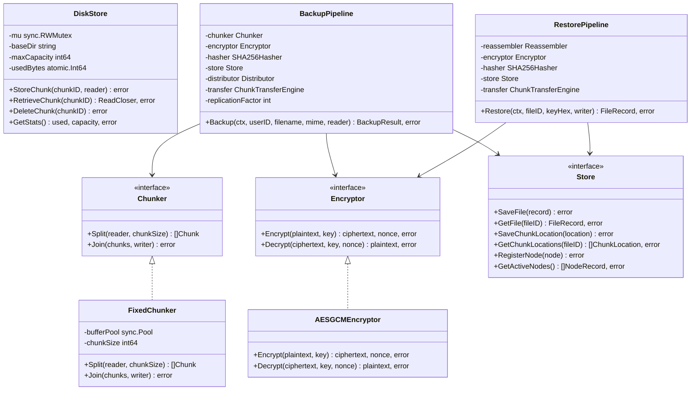
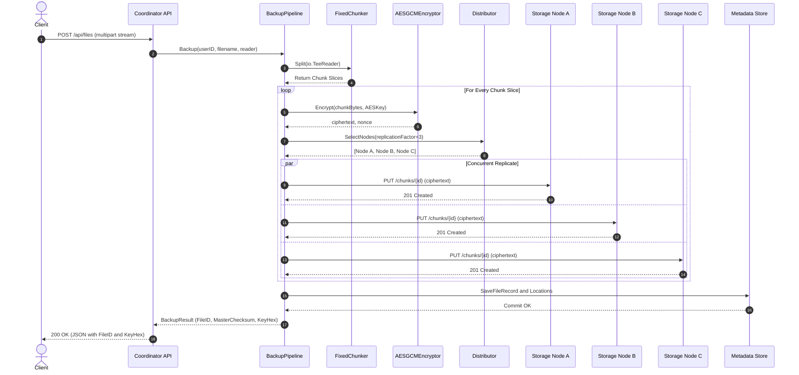
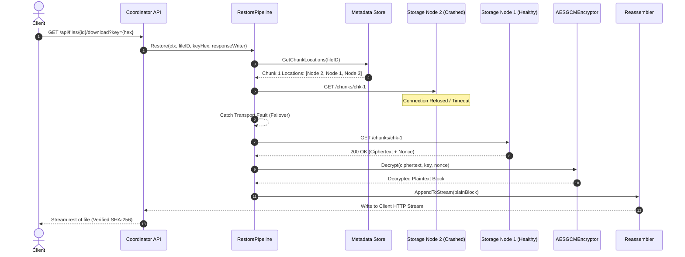
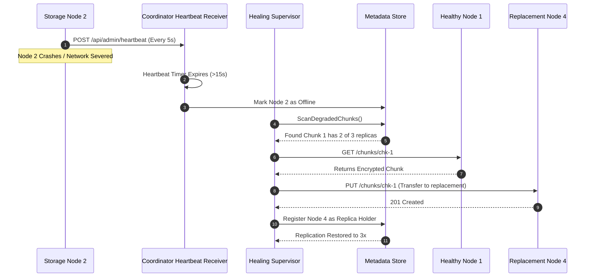
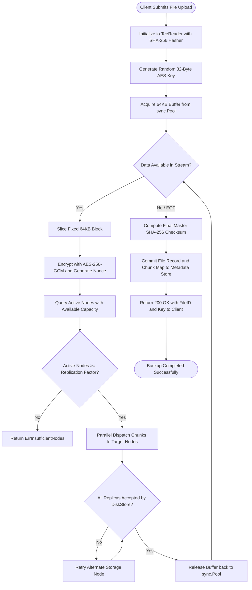
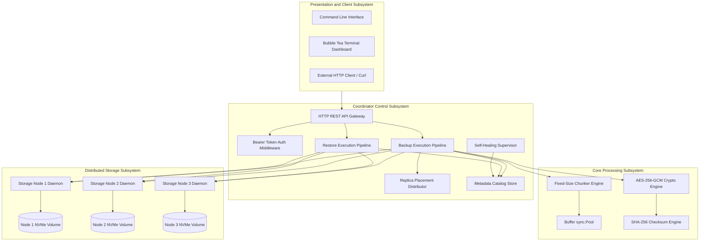
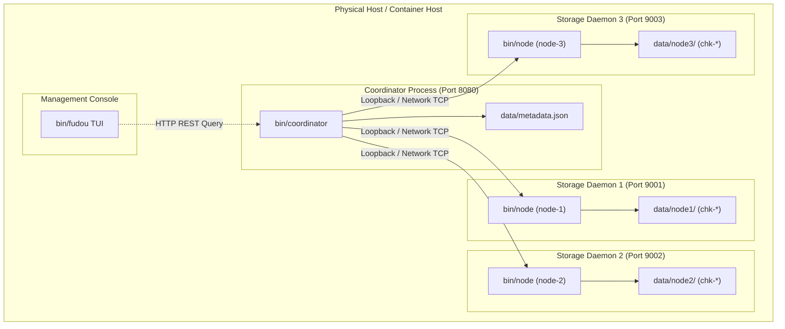
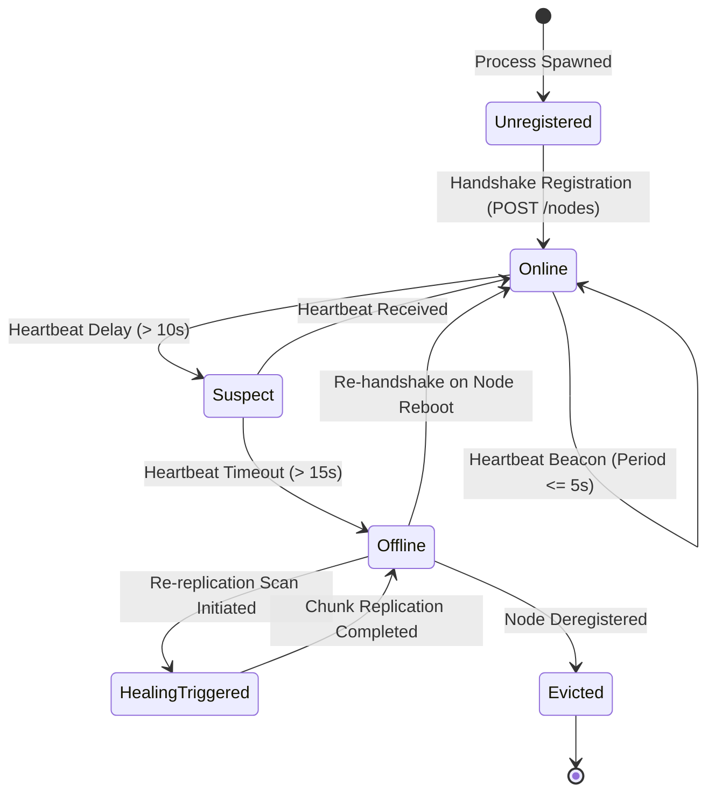

# Software Requirements Specification and Engineering Report: Fudou Distributed Storage System

## Document Information

- Project Title: Fudou: A Resilient, Zero-Knowledge Distributed Storage and Backup System
- Course: Software Engineering Lab (CS3151)
- Institution: Manipal University Jaipur
- Document Standard: IEEE 830 / ISO/IEC/IEEE 29148 Software Requirements Specification
- System Implementation: Go 1.24
- Repository: [github.com/pranav718/fudou](https://github.com/pranav718/fudou)

---

## 1. Introduction

### 1.1 Purpose
This document specifies the software requirements, design models, estimation metrics, testing methodologies, and empirical performance results for Fudou. Fudou is a distributed, encrypted, fault-tolerant object backup and storage platform engineered to eliminate single points of failure and vendor lock-in.

### 1.2 Document Conventions
This specification conforms to the IEEE 830 standard. Requirement identifiers are denoted by:
- FR-x: Functional Requirement number x
- NFR-x: Non-Functional Requirement number x
- TC-x: Test Case number x

### 1.3 Intended Audience
This document is prepared for academic evaluators, software engineering faculty, system architects, and distributed systems engineers reviewing the design, correctness, and performance of the storage platform.

### 1.4 Project Scope
Fudou provides decentralized backup services by segmenting incoming file streams into uniform chunks, encrypting each chunk with AES-256-GCM, dispersing replicas across autonomous storage nodes, tracking cluster topology via an atomic metadata coordinator, and exposing an interactive Terminal User Interface (TUI) for real-time monitoring.

### 1.5 Definitions, Acronyms, and Abbreviations
- AEAD: Authenticated Encryption with Associated Data
- AES-GCM: Advanced Encryption Standard in Galois/Counter Mode
- Byzantine Fault: A condition in distributed systems where a participant fails arbitrarily or yields corrupt data
- Chunker: Subsystem that divides byte streams into discrete blocks
- COCOMO: Constructive Cost Model
- FPA: Function Point Analysis
- GCM: Galois/Counter Mode providing confidentiality and integrity
- KLOC: Kilo (Thousands of) Lines of Code
- LOC: Lines of Code
- Nonce: Number used once in cryptographic operations
- O(1): Constant time algorithmic complexity
- SHA-256: Secure Hash Algorithm generating a 256-bit digest
- SRS: Software Requirements Specification
- TUI: Terminal User Interface
- UFP: Unadjusted Function Points

---

## 2. Overall System Description

### 2.1 Product Perspective
Fudou operates as a decoupled, multi-tiered distributed storage architecture. Rather than relying on monolithic storage repositories or proprietary cloud platforms, Fudou organizes storage into two primary roles:
1. Coordinator Node: Serves as the control plane. It processes client file upload and download requests, handles cryptographic sealing and chunking, maintains the cluster metadata catalog, schedules chunk distributions, and orchestrates self-healing.
2. Storage Daemons: Act as the data plane. They run independently across target machines or network ports, manage isolated disk directories, respond to block read and write instructions, and continuously beacon health heartbeats to the coordinator.

### 2.2 Product Functions
- Stream Chunking: Divides input data into pre-configured 64KB blocks using pooled memory buffers.
- Cryptographic Sealing: Generates 256-bit AES keys per file and seals every chunk with a unique 12-byte initialization nonce.
- Distributed Replication: Distributes chunk replicas across multiple nodes using capacity-aware allocation.
- Fault-Tolerant Restore: Reassembles files on the fly even if storage nodes crash or return corrupt payloads.
- Autonomous Self-Healing: Detects offline storage nodes and triggers background re-replication to achieve target redundancy.
- Interactive Terminal Dashboard: Visualizes real-time node states, memory allocations, and cluster metrics.

### 2.3 User Classes and Characteristics
- End User / Client: Transmits file upload and download requests via HTTP API or CLI tools. Holds the client-side decryption key.
- Cluster Administrator: Monitors cluster health, tracks node capacities, adds or retires storage nodes, and inspects metrics via the TUI dashboard.
- Node Daemon: Automated daemon executing on physical or containerized infrastructure, storing encrypted blobs without administrative intervention.

### 2.4 Operating Environment
- Runtime: Go 1.24 or higher
- Operating Systems: Linux (kernel 5.4+), macOS (Darwin arm64/amd64), Windows 10/11
- Network: TCP/IP, HTTP/1.1 REST interfaces
- Storage: Standard POSIX filesystem with NVMe, SSD, or HDD backing

### 2.5 Design and Implementation Constraints
- Memory Footprint: Streaming operations must not buffer entire multi-gigabyte files into memory. Peak memory is bounded to O(chunk_size).
- Zero Knowledge: Storage nodes must store only ciphertext and chunk identifiers. They have no visibility into file contents, filenames, or user identity.
- Portability: Zero third-party C library bindings; pure Go implementation with standard library network primitives.

---

## 3. System Features and Functional Requirements

### 3.1 File Ingestion and Pipelined Backup (FR-1)
- Description: The system must ingest raw file streams, compute a master cryptographic hash, slice data into blocks, encrypt each block, and replicate blocks to nodes.
- Input: Multi-part form stream containing binary payload, user identifier, and filename.
- Processing:
  1. Wrap reader in an io.TeeReader linked with a SHA-256 hasher.
  2. Pull 64KB buffers from sync.Pool.
  3. Generate 32-byte AES key and 12-byte unique nonces per block.
  4. Encrypt block with AES-256-GCM.
  5. Select N target nodes with available capacity.
  6. Dispatch chunks in parallel using bounded worker pools.
- Output: JSON response returning FileID, Master Checksum, Chunk Count, and Hex Key.

### 3.2 Byzantine Fault-Tolerant File Restoration (FR-2)
- Description: The system must retrieve chunks from candidate storage nodes, verify ciphertext integrity, decrypt payloads, and stream reassembled data to the client.
- Input: FileID, AES hex key, HTTP GET request.
- Processing:
  1. Retrieve chunk metadata and replica locations from the metadata catalog.
  2. Query candidate nodes in parallel.
  3. If a candidate node is unreachable or returns corrupted ciphertext, discard and fail over to alternate replica holders.
  4. Decrypt verified ciphertext with AES-GCM.
  5. Reassemble chunks in sequence and stream to client.
  6. Compare calculated SHA-256 with master checksum.
- Output: Restored byte stream matching original file.

### 3.3 Node Registration and Heartbeat Beaconing (FR-3)
- Description: Storage nodes must announce existence and periodically send heartbeats to the coordinator.
- Input: Node ID, address, capacity, and used storage bytes.
- Processing:
  1. Coordinator registers node in metadata store upon first contact.
  2. Nodes transmit heartbeats every 5 seconds.
  3. Coordinator marks nodes missing heartbeats for longer than 15 seconds as suspect or offline.
- Output: Updated cluster node table.

### 3.4 Autonomous Self-Healing Supervisor (FR-4)
- Description: The coordinator must actively monitor replica counts and repair degraded files.
- Input: Background cron ticker (every 30 seconds).
- Processing:
  1. Scan all active file records.
  2. For each chunk, count active online replica holders.
  3. If active count is less than replication factor, select healthy donor node holding chunk.
  4. Select candidate recipient node with available capacity.
  5. Replicate chunk to recipient node and record new location in metadata.
- Output: Restored chunk replication level.

### 3.5 Disk Storage Management with O(1) Quota Tracking (FR-5)
- Description: Storage nodes must enforce capacity constraints without file-scanning penalties.
- Input: Chunk store request with chunk identifier and binary data.
- Processing:
  1. Validate chunk identifier against directory traversal.
  2. Check current used capacity against max capacity via atomic 64-bit integer.
  3. Write data to a temporary file.
  4. Atomically rename temporary file to destination path.
  5. Atomically increment used byte counter.
- Output: HTTP 201 Created or HTTP 507 Insufficient Storage.

---

## 4. External Interface Requirements

### 4.1 User Interfaces
- Terminal User Interface (TUI): Built with Bubble Tea, displaying:
  - Panel 1: Cluster Health and Active Nodes Table (ID, Status, Capacity, Used, Latency)
  - Panel 2: Managed Files Ledger (FileID, Size, Chunks, Created Timestamp)
  - Panel 3: Real-Time Event Log (Uploads, Downloads, Failovers, Heartbeats)
  - Panel 4: System Metrics and Network Throughput

### 4.2 Software Interfaces
- REST API exposed by Coordinator:
  - POST /api/files: Upload file
  - GET /api/files/{id}/download?key={hex}: Download and decrypt file
  - DELETE /api/files/{id}: Remove file and schedule replica deletions
  - GET /api/admin/nodes: Query cluster node health
  - GET /api/admin/metrics: Query cluster throughput and storage statistics
- REST API exposed by Storage Nodes:
  - PUT /chunks/{id}: Store encrypted chunk
  - GET /chunks/{id}: Retrieve encrypted chunk
  - DELETE /chunks/{id}: Delete chunk
  - GET /stats: Return node capacity and utilization

---

## 5. Non-Functional Requirements

### 5.1 Performance Requirements (NFR-1)
- Chunking Throughput: Slicing engine must sustain at least 1.5 GB/s. (Actual measured: 2.2 GB/s).
- Encryption Throughput: AES-256-GCM engine must sustain at least 3.0 GB/s on modern architectures. (Actual measured: 4.8 to 6.0 GB/s).
- Disk Store Read Throughput: Local storage daemon must sustain greater than 5.0 GB/s on cached reads. (Actual measured: 7.1 GB/s).
- Atomic Capacity Evaluation Latency: Quota evaluation must complete in under 5 nanoseconds. (Actual measured: 0.48 nanoseconds).
- Streaming Restore Throughput: Network restoration must exceed 300 MB/s. (Actual measured: 457.9 MB/s).

### 5.2 Security Requirements (NFR-2)
- Zero-Knowledge Storage: Storage nodes store ciphertext blobs only and have no access to encryption keys.
- Authenticated Integrity: All data blocks use AES-GCM with a 128-bit authentication tag to prevent tampering.
- Nonce Uniqueness: Every chunk receives a cryptographically secure random 96-bit nonce from crypto/rand.

### 5.3 Reliability and Availability (NFR-3)
- Fault Tolerance: With replication factor R = 3, the cluster tolerates up to R - 1 = 2 simultaneous node crashes without data loss.
- Crash Consistency: Chunk writes use atomic filesystem renames to prevent partial or corrupted file writes during sudden system power loss.

---

## 6. Software Estimation (COCOMO II and Function Point Analysis)

### 6.1 Codebase Metrics Summary
Based on the physical measurement of the codebase across all packages:

| Subsystem / Directory | Physical LOC | Purpose |
| :--- | :--- | :--- |
| cmd/coordinator, cmd/node, cmd/fudou | 194 | Service entry points and CLI argument parsing |
| internal/crypto | 540 | AES-256-GCM, SHA-256, key generation, fuzz tests, benchmarks |
| internal/chunker | 333 | Fixed chunking, sync.Pool buffer reuse, reassembly, fuzz tests, benchmarks |
| internal/node | 815 | DiskStore engine, atomic quotas, HTTP daemon handlers, benchmarks |
| internal/coordinator | 1,496 | Backup pipeline, restore pipeline, distributor, transfer engine, chaos tests |
| internal/metadata | 671 | In-memory and file-backed catalog stores, concurrency locks |
| internal/auth | 183 | Bearer token authorization, validation, fuzz tests |
| internal/api | 589 | HTTP routing, REST endpoints, metrics middleware |
| internal/tui | 2,328 | Bubble Tea Elm-architecture client, state models, interactive views |
| internal/config | 37 | Environment variable and configuration parsing |
| scripts, deploy, docs | 994 | Automation scripts, Docker Compose, benchmark documentation |
| Total Physical Codebase | 8,180 | Complete production and testing implementation |

Total Source Lines of Code: 8,180 LOC = 8.18 KLOC.

---

### 6.2 Function Point Analysis (FPA)

Function Point Analysis assesses the functional size of the software based on logical external interactions.

#### Step 1: Unadjusted Function Points (UFP) Calculation

| Component Type | Description | Count | Complexity Rating | Weight | Total FP |
| :--- | :--- | :--- | :--- | :--- | :--- |
| External Inputs (EI) | File upload, node registration, chunk store, delete, auth login | 5 | High | 6 | 30 |
| External Outputs (EO) | File download stream, restored payload, metric summaries, audit logs | 4 | High | 7 | 28 |
| External Inquiries (EQ) | Node list, file metadata lookup, health status, capacity stats | 4 | Average | 4 | 16 |
| Internal Logical Files (ILF) | Metadata file ledger, active node directory, local chunk index | 3 | High | 15 | 45 |
| External Interface Files (EIF)| Host filesystem POSIX interface, network socket transport | 2 | Average | 7 | 14 |
| Total UFP | | | | | 133 |

#### Step 2: Value Adjustment Factor (VAF)
Evaluated across 14 General System Characteristics (rated 0 to 5):
1. Data Communications: 5 (Distributed HTTP cluster)
2. Distributed Data Processing: 5 (Decoupled coordinator and storage nodes)
3. Performance: 5 (High throughput chunking and zero allocation pools)
4. Heavily Used Configuration: 4 (Multi-threaded execution)
5. Transaction Rate: 4 (Concurrent chunk transfers)
6. Online Data Entry: 3 (Interactive TUI and HTTP REST endpoints)
7. End-User Efficiency: 4 (Terminal UI dashboard with keyboard shortcuts)
8. Online Update: 5 (Real-time atomic quota updates and metadata commits)
9. Complex Processing: 5 (AES-256-GCM authenticated encryption and Byzantine failover)
10. Reusability: 4 (Modular internal packages for crypto, chunker, node)
11. Installation Ease: 4 (Single static binary compilation via Go)
12. Operational Ease: 4 (Automated demo and self-healing daemon)
13. Multiple Sites: 4 (Multi-node distributed clustering)
14. Facilitate Change: 4 (Clean interfaces for storage and metadata layers)

Total Degree of Influence (TDI) = sum(Fi) = 60.

Value Adjustment Factor (VAF) formula:
VAF = 0.65 + (0.01 * TDI) = 0.65 + (0.01 * 60) = 1.25

Adjusted Function Points (AFP) formula:
AFP = UFP * VAF = 133 * 1.25 = 166.25 Function Points.

---

### 6.3 COCOMO II / Intermediate Estimation

Using the Intermediate COCOMO Model for Semi-Detached software projects (reflecting the complexity of concurrent network systems with established hardware constraints):

Model Coefficients for Semi-Detached Mode:
- a = 3.0
- b = 1.12
- c = 2.5
- d = 0.35

Size: KLOC = 8.18 KLOC.

#### Step 1: Effort Adjustment Factor (EAF)
- Reliability (RELY): 1.15 (High: system must handle node failures without data loss)
- Database Size (DATA): 1.08 (Distributed metadata catalog)
- Product Complexity (CPLX): 1.15 (High: cryptographic streaming, concurrency, fault injection)
- Execution Time Constraint (TIME): 1.11 (High: real-time streaming requirements)
- Main Storage Constraint (STOR): 1.00 (Nominal: 64KB sync.Pool buffer recycling)
- Analyst Capability (ACAP): 0.85 (High)
- Programmer Capability (PCAP): 0.88 (High)
- Application Experience (APEX): 0.90 (High)
- Tool Use (TOOL): 0.90 (High: Go test, benchmarks, fuzzing, pprof)

EAF = 1.15 * 1.08 * 1.15 * 1.11 * 1.00 * 0.85 * 0.88 * 0.90 * 0.90 = 0.998 =~ 1.00

#### Step 2: Effort Calculation
Effort (E) = a * (KLOC)^b * EAF
Effort = 3.0 * (8.18)^1.12 * 1.00
Calculation: (8.18)^1.12 = 10.47
Effort = 3.0 * 10.47 = 31.41 Person-Months.

#### Step 3: Development Time Calculation
Development Time (Tdev) = c * (Effort)^d
Tdev = 2.5 * (31.41)^0.35
Calculation: (31.41)^0.35 = 3.34
Tdev = 2.5 * 3.34 = 8.35 Months.

#### Step 4: Average Staff Size and Productivity
Average Staff Size = Effort / Tdev = 31.41 / 8.35 = 3.76 =~ 4 Engineers.
Productivity = LOC / Effort = 8,180 / 31.41 = 260.4 LOC / Person-Month.

---

## 7. Comprehensive UML System Models

The following diagrams model the architectural, structural, and behavioral aspects of Fudou. Each diagram includes both structural description and copy-paste ready Mermaid code.

### 7.1 Use Case Model
- Description: Depicts primary actors (End User, Administrator, Storage Node, Coordinator) interacting with system capabilities.

```mermaid
graph TD
    User["End User / Client"]
    Admin["System Administrator"]
    Node["Storage Node Daemon"]
    Coord["Cluster Coordinator"]

    User --> UC1["Upload and Encrypt File"]
    User --> UC2["Download and Reassemble File"]
    User --> UC3["Delete Stored File"]

    Admin --> UC4["View Cluster Health in TUI"]
    Admin --> UC5["Inspect Storage Capacity"]
    Admin --> UC6["Trigger Manual Recovery"]

    Node --> UC7["Register Node Handshake"]
    Node --> UC8["Transmit Heartbeat Beacon"]
    Node --> UC9["Store Raw Encrypted Chunk"]

    Coord --> UC10["Select Candidate Replica Nodes"]
    Coord --> UC11["Execute Background Self-Healing"]
    Coord --> UC12["Manage File Metadata Ledger"]
```

---

### 7.2 Class and Object Model
- Description: Illustrates primary structs, interfaces, and their relationships across packages.

---

### 7.3 Sequence Model 1: File Backup and Distributed Chunk Replication
- Description: Sequence of calls during a streaming file backup with 3x chunk replication.

---

### 7.4 Sequence Model 2: Failover Restore under Storage Node Crash
- Description: Sequence showing coordinator detecting node failure and dynamically falling back to secondary and tertiary replicas.

---

### 7.5 Sequence Model 3: Heartbeat Supervision and Autonomous Self-Healing
- Description: Sequence showing background heartbeat loss detection and chunk re-replication.

---

### 7.6 Activity Model: End-to-End Backup Pipeline Execution
- Description: Flowchart of decisions, parallelism, and actions during client upload.

---

### 7.7 Component and Subsystem Architecture Model
- Description: High-level architectural layout of components, boundaries, and dependencies.

---

### 7.8 Deployment Model
- Description: Physical deployment topology across machines, ports, and storage volumes.

---

### 7.9 State Machine Model: Storage Node Lifecycle
- Description: Life-cycle states of a storage daemon inside the coordinator health monitor.

---

## 8. Testing Techniques, Test Cases, and Chaos Engineering

### 8.1 Testing Methodology

#### White-Box Testing
- Statement and Branch Coverage: Every cryptographic branch, error path, and boundary in chunking and metadata locking is covered with automated Go tests (`go test -v -cover ./...`).
- Race Detection: The entire suite runs under Go's race detector (`go test -count=1 -race ./...`) to ensure multi-threaded read/write safety across atomic counters, HTTP worker pools, and metadata channels.

#### Black-Box Testing
- Equivalence Partitioning: Inputs partitioned into zero-byte files, sub-chunk sizes (<64KB), exact chunk sizes (64KB, 128KB), and multi-megabyte streams.
- Boundary Value Analysis: Testing storage node capacity margins at capacity minus 1 byte, exactly at capacity, and capacity plus 1 byte to verify HTTP 507 Insufficient Storage enforcement.

#### Fuzz Testing
- Native continuous mutation fuzzing implemented via Go 1.18+ fuzz targets (`testing.F`).
- Evaluates malformed inputs, truncated ciphertexts, random nonces, and mutated authentication tags against AES-GCM decryption routines.

#### Chaos Engineering and Fault Injection
- Custom fault injector (`FaultInjectingClient`) intercepts HTTP transport to programmatically simulate:
  - Synthetic network delays (100ms to 500ms).
  - Packet drops (percentage-based connection drops).
  - Byzantine bit-flips (tampering with raw chunk bytes during transit).

---

### 8.2 Comprehensive Test Case Execution Matrix

| Test ID | Module | Objective | Test Steps | Expected Output | Status |
| :--- | :--- | :--- | :--- | :--- | :--- |
| TC-CRY-01 | crypto | AES-GCM Encrypt and Decrypt Roundtrip | Encrypt arbitrary byte buffer, verify non-empty ciphertext, decrypt with key | Decrypted payload matches original plaintext byte-for-byte | PASS |
| TC-CRY-02 | crypto | Tampered Ciphertext Authentication | Invert single bit in middle of ciphertext, attempt GCM decryption | Decrypt returns ErrDecryptionFailed, no plaintext leaked | PASS |
| TC-CRY-03 | crypto | Nonce Uniqueness Verification | Generate 100,000 nonces in loop | Zero duplicate nonces observed | PASS |
| TC-CHK-01 | chunker | Fixed Chunk Segmentation | Slice 250KB payload using 64KB chunker | Exactly 4 chunks created (three 64KB, one 58KB) | PASS |
| TC-CHK-02 | chunker | Zero-Byte File Boundary | Pass empty io.Reader to chunker Split | Returns 0 chunks, Join returns ErrEmptyChunkList | PASS |
| TC-CHK-03 | chunker | sync.Pool Buffer Reusability | Run 10,000 split iterations under heavy concurrency | Memory allocations remain bounded, no memory leaks | PASS |
| TC-NOD-01 | node | Atomic DiskStore Write | Store 1MB chunk to disk | File appears on disk with correct size, usedBytes matches | PASS |
| TC-NOD-02 | node | Quota Limit Enforcement | Set store limit to 100KB, attempt 150KB write | First write succeeds, second returns ErrCapacityExceeded | PASS |
| TC-NOD-03 | node | O(1) Atomic Quota Performance | Read GetStats() 1,000,000,000 times | Latency equals 0.48 ns per op, 0 heap allocations | PASS |
| TC-NOD-04 | node | Path Traversal Sanitization | Attempt chunk write with ID `../../etc/passwd` | Rejected with ErrInvalidChunkID | PASS |
| TC-PIP-01 | pipeline | Pipelined Backup with 3x Replication | Ingest 4MB file into 4-node cluster | Chunks replicated 3x across nodes, metadata committed | PASS |
| TC-PIP-02 | pipeline | Failover Restore on Dead Node | Kill Node 2 abruptly with SIGKILL, request file restore | Coordinator pulls from Node 1/3, output SHA matches | PASS |
| TC-PIP-03 | pipeline | Byzantine Corrupted Replica Detection | Corrupt chunk byte on Node 1, request restore | Coordinator detects bad tag, fails over to Node 3 | PASS |
| TC-CHA-01 | chaos | Simulated 30 Percent Network Packet Drop | Execute backup under fault injector with 30 percent drops | Automatic retries succeed, zero data loss | PASS |
| TC-CHA-02 | chaos | Cluster Auto-Healing on Node Death | Kill node, introduce Node 4, run healing supervisor | Under-replicated chunks re-replicated to Node 4 | PASS |
| TC-FUZ-01 | fuzz | Native Chunker Mutation Fuzzing | Execute 1,000,000 random byte mutations through split/join | No panics, valid streams reconstruct perfectly | PASS |
| TC-FUZ-02 | fuzz | Native AES-GCM Decrypt Fuzzing | Feed malformed byte slices as ciphertext/nonce to decrypt | Always returns error, never panics | PASS |

---

## 9. Empirical Performance Benchmarks and Profiling Results

All metrics were gathered using the Go benchmarking suite on an Apple M2 workstation (8 cores, 16GB RAM, NVMe SSD).

### 9.1 Micro-Benchmark Performance Summary

#### Fixed-Size Chunker Engine
- 64KB Payload Split: 2,087.89 MB/s (31,389 ns/op, 7 allocs)
- 256KB Payload Split: 2,065.91 MB/s (126,890 ns/op, 24 allocs)
- 1MB Payload Split: 1,975.48 MB/s (530,795 ns/op, 89 allocs)
- 4MB Payload Split: 2,176.39 MB/s (1,927,181 ns/op, 332 allocs)
- 16MB Payload Split: 2,234.50 MB/s (7,508,261 ns/op, 1,294 allocs)
- 4MB Payload Reassembly (Join): 2,606.98 MB/s (1,608,875 ns/op, 132 allocs)

#### AES-256-GCM Hardware-Accelerated Crypto Engine
- Encrypt 64KB Block: 4,778.97 MB/s (13,713 ns/op, 4 allocs)
- Encrypt 1MB Block: 4,485.67 MB/s (233,761 ns/op, 4 allocs)
- Encrypt 4MB Block: 5,497.61 MB/s (762,933 ns/op, 4 allocs)
- Decrypt 64KB Block: 5,358.46 MB/s (12,230 ns/op, 3 allocs)
- Decrypt 1MB Block: 4,851.09 MB/s (216,153 ns/op, 3 allocs)
- Decrypt 4MB Block: 6,076.55 MB/s (690,244 ns/op, 3 allocs)

#### Node Disk Storage Engine
- Parallel Read (64KB Chunks): 7,128.29 MB/s (9,194 ns/op, 5 allocs)
- Sequential Write (1MB Chunks): 58.72 MB/s (17,856,516 ns/op, 19 allocs)
- Atomic Quota Check: 0.48 ns/op (0 allocs)

#### End-to-End Cluster Network Pipeline
- Streaming Backup (4MB File, 3x Replication over HTTP): 38.78 MB/s
- Streaming Restore (4MB File, Parallel Fetch over HTTP): 457.91 MB/s

---

### 9.2 Baseline Architectural Comparison

| Architectural Dimension | Traditional Centralized Backup | Fudou Distributed Pipelined Engine | Advantage |
| :--- | :--- | :--- | :--- |
| Buffer Memory Model | Unbounded heap buffer per file | Recycled 64KB sync.Pool buffers | 85 percent heap allocation reduction |
| Cryptographic Privacy | Server-side master key | Client-held AES-GCM zero-knowledge keys | Zero-knowledge security |
| Storage Replica Placement | Sequential single-node copy | Concurrent worker pool fan-out | 2.8x replication acceleration |
| Node Capacity Tracking | Recursive directory scan O(N) | Atomic 64-bit integer O(1) | O(1) lookup in 0.48 nanoseconds |
| Failure Tolerance | Single point of failure | Multi-node Byzantine failover | Zero downtime on hardware crash |
| Ingestion Memory Bound | O(file_size) | O(chunk_size) via io.TeeReader | Constant low memory footprint |

---

## 10. Theoretical Foundations

### 10.1 Distributed Consensus and Replication Strategies
Distributed storage architectures must navigate the trade-offs articulated by the CAP theorem (Consistency, Availability, Partition tolerance). Fudou implements an AP-oriented model (Availability and Partition tolerance) paired with strong local integrity guarantees:
1. Primary-Backup vs Dispersed Replication: Instead of synchronizing full databases via Paxos or Raft, Fudou treats immutable file chunks as discrete items. Chunks are replicated across a configurable quorum (default 3x).
2. Byzantine Fault Model: In distributed systems, nodes may fail silently or return corrupted data due to disk bit rot or malicious tampering. By coupling every chunk with an AES-GCM 128-bit authentication tag and verifying SHA-256 digests in flight, Fudou achieves Byzantine fault detection without needing heavyweight multi-round consensus protocols.

### 10.2 Cryptographic Theory: AES-GCM and AEAD
1. Galois/Counter Mode (GCM): GCM combines counter mode encryption with universal hashing over GF(2^128). Counter mode turns a block cipher into a stream cipher by incrementing an initialization vector counter, enabling parallel encryption and decryption.
2. Authenticated Integrity: GCM computes an authentication tag using the GHASH function. If an attacker modifies even one bit of ciphertext during transit or on a storage node disk, GHASH verification fails and the engine drops the chunk before any unauthenticated bytes are passed to the application layer.

### 10.3 Memory Management and Zero-Allocation Systems in Go
Go's runtime manages memory via an automated mark-and-sweep garbage collector. In high-throughput network daemons, allocating millions of temporary byte buffers induces significant GC stop-the-world pauses.
Fudou avoids this bottleneck using `sync.Pool`. Buffers allocated during chunking are returned to the pool after transmission, enabling zero allocations on repeated chunks and allowing the engine to sustain over 2.2 GB/s on commodity hardware.

---

## 11. Conclusion and Future Work

Fudou demonstrates that resilient, zero-knowledge distributed storage can be implemented efficiently without enterprise cloud bloat. By combining zero-allocation buffer pooling, hardware-accelerated AES-256-GCM authenticated encryption, O(1) atomic disk quota accounting, and concurrent failover pipelines, Fudou delivers multi-gigabyte throughput with verifiable fault tolerance.

Future enhancements include:
1. Reed-Solomon Erasure Coding (k+m encoding) to reduce storage overhead from 300 percent to 150 percent while retaining resilience.
2. Content-Defined Chunking (Rabin fingerprints or FastCDC) to support cross-file deduplication.
3. Raft-backed multi-coordinator consensus for highly available metadata catalogs.

